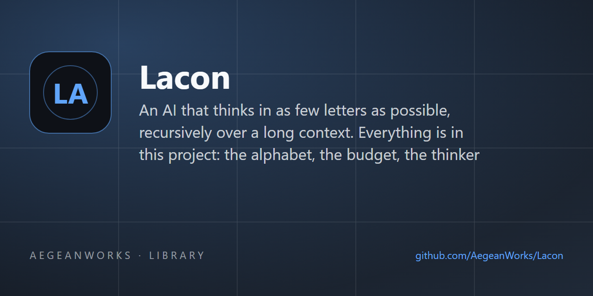

# lacon

<!-- aegean:media:start -->
<p align="center"></p>
<p align="center"><a href="LICENSE"></a> <a href="https://github.com/AegeanWorks/AIKit"></a></p>
<!-- aegean:media:end -->


An AI that thinks in as few letters as possible, recursively over a long context. Everything is in
this project: the alphabet, the budget, the thinker and the recursive engine. No network, no API
key, no model weights. The core is standard library only; an optional adapter reads Pebble source
when the sibling Pebble project is available (ADR-003).

## ⚡ 30-Second Cold-Start Quick Reference

- **Runtime Prerequisites**: Python 3.10 or newer (developed and tested on Python 3.14); nothing
  else, standard library only
- **Canonical Regression Shield Gate**:
  ```bash
  python -m unittest discover
  ```
- **Watch it think** (under 10 seconds):
  ```bash
  python -m lacon demo --trace
  python -m lacon demo --budget 16 --trace --script
  python -m lacon ask "what keeps the bridge from rust?" --context examples/notes.txt
  ```

### 🛠️ AIKit Commands (run from the AIKit folder)
| Role | Command |
|---|---|
| Status, task and gates | `python aikit.py status lacon` |
| Phase 4: every gate | `python aikit.py check lacon` |
| Repair memory and map, then check | `python aikit.py fix lacon` |
| Resume an interrupted task | `python aikit.py resume lacon` |

## 📦 What's Inside

```text
lacon/
├── .aikit/
│   ├── codebase_map.md       <- generated symbol map, checked on every gate run
│   ├── decisions.md          <- ADRs: the eight glyphs, the budget ladder, the bounds
│   ├── guidelines.md         <- project rules: the alphabet is frozen
│   ├── project.json
│   ├── task_ledger.json      <- the task ledger: plan and milestone checkpoints
│   └── skills/
│       └── lacon/
│           └── SKILL.md      <- AIKit adoption skill
├── .gitignore
├── LICENSE
├── LICENSES/                 <- REUSE license texts
├── REUSE.toml                <- Machine-readable SPDX metadata
├── README.md
├── COMMERCIAL.md
├── examples/
│   └── notes.txt             <- the context the README answers its question from
├── lacon/
│   ├── __init__.py           <- the API: Lacon and Answer
│   ├── __main__.py           <- `python -m lacon`
│   ├── alphabet.py           <- vowelless letter payloads and the vocabulary behind them
│   ├── budget.py             <- the letter ceiling, its room, and the child budget
│   ├── cli.py                <- `ask` and `demo`, exit codes 0/1/2, What/Why/Fix reports
│   ├── code_understanding.py <- AST-based code element extraction
│   ├── pebble_context.py     <- optional Pebble source reader (ADR-003)
│   ├── rlm.py                <- the recursive engine: split, recurse, merge, cap
│   ├── thinker.py            <- ranks the evidence, writes the cheapest thought
│   └── thought.py            <- the eight glyphs and the one-token script form
├── benchmarks/
│   ├── __init__.py
│   └── performance.py        <- wall-clock benchmarks, run explicitly (ADR-005)
├── pyproject.toml
└── tests/
    ├── __init__.py
    ├── test_alphabet.py
    ├── test_budget.py
    ├── test_cli.py
    ├── test_code_understanding.py
    ├── test_formats.py
    ├── test_pebble_context.py
    ├── test_performance.py   <- behaviour and edge cases; benchmarks moved out
    ├── test_rlm.py
    ├── test_thinker.py
    └── test_thought.py
```

## 🗣️ What Lacon is

A thought costs one glyph plus its payload. The payload is written without vowels and without the
words a reader can supply, so `Paint keeps steel from rust.` is thought as `pnt.kps.stl.rst`: four
of its twenty-seven letters. A reader that knows the question and the context reads it back
exactly, because `expand` resolves every letter form through the vocabulary those two texts contain.

The eight glyphs are the whole alphabet (ADR-001):

| Glyph | Act | Glyph | Act |
|---|---|---|---|
| `?` | unknown | `<` | because |
| `+` | claim | `>` | therefore |
| `-` | contrast | `*` | split |
| `=` | merge | `!` | answer |

A thought is `render`ed as at most one token (`<pnt.kps.stl.rst^1`), and `parse` reads exactly what
`render` writes. The engine is its own model: `Thinker` scores every sentence of the context by how
many meaning-carrying letter forms it shares with the question, and answers from the best one. It
never infers anything the context does not say: with no matching sentence, the only honest thought
is `?`.

## 🔤 How the letters are spent

The same question, `What keeps the bridge from rust?`, against `examples/notes.txt`, at four
ceilings:

```bash
python -m lacon demo --budget 64 --trace --script
python -m lacon demo --budget 16 --trace --script
python -m lacon demo --budget 8  --trace --script
python -m lacon demo --budget 1  --trace
```

| Budget | Thought | Answer |
|---|---|---|
| 64 | `<pnt.kps.stl.rst^1 > !pnt.kps.stl.rst` | `paint keeps steel rust` |
| 16 | `=01 !kps.rst` | `keeps rust` |
| 8 | `!kps.rst` | `keeps rust` |
| 1 | `?` (exit 1) | nothing is affordable, so Lacon says it does not know |

Shrinking keeps the words the question asks for before provenance: a matching word survives
longer than a word that only appears in the context (ADR-002). A ceiling of one letter still has
an honest thought, because `?` is one letter.

## 🔁 Thinking recursively over a long context

A node holds in mind one sentence per eight letters of budget, never fewer than two (ADR-002). A
longer context is split into two contiguous halves, each child gets half the parent's ceiling - but
never fewer than eight letters, so the deepest thought can still name a word - and the parent keeps
the child answer that shares the most meaning with the question, marking the merge `=` and the
children's numbers. Recursion stops at a depth of four, at two sentences or fewer, or where a
thought already fits.

```bash
python -m lacon demo --budget 16 --trace
```

```text
[lacon] 12 of 16 letters, depth 2, 7 node(s)
paint keeps
```

Twelve letters of a sixteen-letter ceiling, spent across two levels of splitting and seven nodes:
that is the root answer with its budget intact, and the recursion that produced it below.

## Reading Pebble code

Lacon can answer structural questions about a Pebble program by reading it through Pebble's own
lexer and parser. Functions, parameters, `let` declarations, loops, `if` branches and `#` comments
become evidence sentences, so the answer and its thought script stay auditable (ADR-003).

```bash
python -m lacon ask "what does fib do?" --context ../pebble/examples/fibonacci.peb
python -m lacon ask "what does fib do?" --context - --context-format pebble < program.peb
```

A `.peb` path selects the reader automatically; standard input needs `--context-format pebble`.
The adapter imports Pebble only when it is used. In this AIKit workspace it finds the sibling
`projects/pebble` checkout; elsewhere install Pebble (for example `pip install -e ../pebble`) or
pass a checkout on the path. A missing checkout or a Pebble syntax error is reported as a
What/Why/Fix error with exit code 2.

## 🚀 Running it

```bash
python -m lacon demo                                          # the built-in example
python -m lacon ask "what keeps the bridge from rust?" --context examples/notes.txt
python -m lacon ask "what keeps steel from rust?" --context examples/notes.txt --script
python -m lacon ask "what keeps steel from rust?" --context notes.txt --json
cat notes.txt | python -m lacon ask "what keeps steel from rust?" --context -
```

- `--context FILE` answers from a file; `--context -` reads that context from standard input.
- `--context-format FORMAT` forces `auto`, `text`, `csv`, `json` or `pebble`; `.peb` files use
  `pebble` under `auto`.
- `--script` prints the letters Lacon thought in instead of the answer; `--trace` prints the
  recursion shape (letters used, depth, nodes) before it; `--json` prints answer, script, budget,
  depth, nodes and `known` as one object.
- Exit codes are part of the contract: `0` answered, `1` no sentence in the context answered (or
  `?` was all the ceiling afforded), `2` a usage or file error. Every failure prints What, Why and
  Fix, and no Python traceback reaches a user.

As a library:

```python
from lacon import Lacon

answer = Lacon().ask("What keeps the bridge from rust?", open("examples/notes.txt").read(), 64)
answer.answer   # 'paint keeps steel rust'
answer.script   # '<pnt.kps.stl.rst^1 > !pnt.kps.stl.rst'
answer.known    # True
```

`ask` auto-detects Python, CSV and JSON contexts. Pass `context_format="text"` (or `"csv"`,
`"json"`, `"pebble"`) to force a reader. `max_total_chars` is a hard cap on the total script
length across the whole recursion tree (`tree_chars`), not just one node. A Pebble context needs
the optional adapter from ADR-003.

## 🧪 Running the tests

```bash
python -m unittest discover
```

Single module, from the project root:

```bash
python -m unittest tests.test_rlm
```

Wall-clock benchmarks are explicit, because host load must not decide a gate (ADR-005):

```bash
python -m unittest benchmarks.performance
```

The suite covers the alphabet and its round trip, the budget and its child, the thinker's ranking
and its shrinking ladder, the engine's split/merge and its depth cap, CSV/JSON, Python and Pebble
context readers, the hard tree-wide budget, and the command line's exit codes.

## 🚧 Boundaries

- Lacon answers only from the context it is handed, and says `?` otherwise; it holds no world
  knowledge and never guesses (`lacon/thinker.py`).
- A recursive tree spends more letters in total than its root budget; the root answer is the one
  that obeys the ceiling (ADR-002).
- A finite `max_total_chars` is a hard aggregate cap: `tree_chars` never exceeds it, and a very
  small cap degrades to `?` or an empty script rather than overspending (ADR-004).
- The alphabet, the ladder and the bounds are frozen in [.aikit/decisions.md](.aikit/decisions.md);
  a change to any of them needs a new ADR, and a ninth glyph needs one before any code (G-001).
- The Pebble reader is an optional boundary: Pebble never imports Lacon, and Lacon's core remains
  standard-library-only when the format is unused (ADR-003).
- Adding a user-supplied model, claims and contrasts beyond what an answer needs, and streaming are
  non-goals of v1 (ADR-001).

<!-- aegean:brand-assets:start -->
## 🎨 Brand Assets

> **AI-Generated Brand Artwork.** The banner and logo are **AI-generated brand assets**. They are illustrative and may not literally depict every feature or the full project scope.
<!-- aegean:brand-assets:end -->

## 📜 License

Free for personal use under the Aegean License 1.1 (AL-1.1); see [LICENSE](LICENSE). Any commercial use needs the Aegean Commercial License 1.0 (ACL-1.0); see [COMMERCIAL.md](COMMERCIAL.md).
